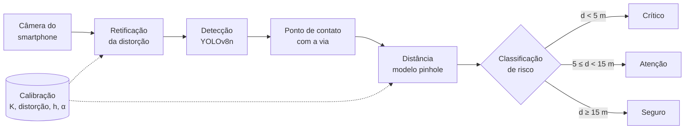

# SARMOV

**Sistema de Alerta Preventivo para Riscos Viários com Estimativa de Distância Monocular em Smartphone**

Projeto de Iniciação Científica (PIBIC) da Universidade Católica Dom Bosco (UCDB), Campo Grande, MS.

- **Autor:** Magnum Johanson de Abreu — Ciência da Computação
- **Orientador:** Allan Rios Bezerra

---

## Resumo

Buracos, objetos sobre a pista e irregularidades no pavimento oferecem risco ao condutor, sobretudo quando percebidos tarde demais para uma manobra segura. Sistemas de assistência ao motorista (ADAS) resolvem parte do problema, mas, em sua maioria, dependem de radar, LiDAR ou câmeras estéreo, o que os mantém fora dos veículos populares.

O SARMOV investiga se **a câmera de um único smartphone** é suficiente para detectar esses riscos e **estimar a distância até eles** com precisão útil para um alerta preventivo. O sistema combina três técnicas consolidadas em um pipeline único:

1. **Detecção** dos elementos de risco com YOLOv8n;
2. **Calibração** da câmera pelo método de Zhang;
3. **Estimativa de distância** por geometria projetiva (modelo *pinhole* sobre o plano da via).

A distância estimada é comparada a limiares derivados da distância de frenagem segura, e o sistema emite um alerta em três níveis. A validação compara distâncias estimadas com medidas reais (trena) em ambiente controlado, de 1 a 15 m.

Trata-se de um trabalho de **integração e validação experimental** de técnicas existentes, não da proposta de novos algoritmos.

## Como funciona

A distância longitudinal até o ponto de contato do objeto com a via é dada por

$$d = \frac{h}{\tan\left(\alpha + \arctan\left(\dfrac{v - v_0}{f_y}\right)\right)}$$

em que $h$ é a altura da câmera, $\alpha$ o ângulo de inclinação, $v$ a coordenada vertical do ponto de referência na imagem, $v_0$ o centro óptico e $f_y$ a distância focal em pixels. Detalhes em [docs/02-arquitetura.md](docs/02-arquitetura.md).

## Metas e estado atual

O projeto está na fase de proposta. **Nenhum resultado experimental foi produzido ainda**; a tabela abaixo registra as metas e os critérios de aceite do plano de trabalho e será preenchida conforme os experimentos forem executados.

| Dimensão | Métrica | Meta | Obtido |
|---|---|---|---|
| Detecção | Precisão e revocação | > 80 % | — |
| Detecção | mAP | > 0,75 | — |
| Distância (1–15 m) | MAE | < 1,5 m | — |
| Distância (1–15 m) | MAPE | < 15 % | — |
| Alerta | Verdadeiros positivos | > 85 % | — |
| Alerta | Falsos positivos | < 15 % | — |
| Desempenho no aparelho | Taxa de quadros | ≥ 10 fps | — |
| Calibração (critério de aceite) | Erro de reprojeção RMS | < 0,5 px | — |

O plano de trabalho registra uma medição preliminar de cerca de 12 fps (83 ms por quadro) com YOLOv8n em TFLite. Ela será refeita de forma controlada na fase de avaliação.

## Roteiro

O trabalho está organizado em oito fases, cada uma com entregas e critérios de aceite próprios. O acompanhamento é feito pelos [marcos do repositório](https://github.com/Magnumja/SARMOV/milestones).

| Fase | Entrega principal | Estado |
|---|---|---|
| [0 · Fundação](docs/fases/fase-0-fundacao.md) | Repositório, documentação e ambiente reprodutível | Em andamento |
| [1 · Fundamentação](docs/fases/fase-1-fundamentacao.md) | Revisão bibliográfica e estudo de YOLO | Planejada |
| [2 · Calibração e coleta](docs/fases/fase-2-calibracao-e-coleta.md) | Parâmetros da câmera e imagens brutas | Planejada |
| [3 · Anotação e dataset](docs/fases/fase-3-anotacao-e-dataset.md) | Dataset anotado e dividido 70/15/15 | Planejada |
| [4 · Pipeline](docs/fases/fase-4-pipeline.md) | Detecção, distância e classificação de risco | Planejada |
| [5 · Avaliação](docs/fases/fase-5-avaliacao.md) | Experimentos, métricas e análise de falhas | Planejada |
| [6 · MVP móvel](docs/fases/fase-6-mvp-movel.md) | Aplicativo Android com alerta em tempo real | Planejada |
| [7 · Artigo](docs/fases/fase-7-artigo.md) | Relatório parcial, relatório final e artigo | Planejada |

## Documentação

| Documento | Conteúdo |
|---|---|
| [Visão geral](docs/01-visao-geral.md) | Problema, objetivos, método e contribuições em uma página |
| [Arquitetura](docs/02-arquitetura.md) | Componentes, fluxo de dados, modelo geométrico e estrutura de código |
| [Roteiro de fases](docs/03-roteiro.md) | Fases, dependências, cronograma e critérios de aceite |
| [Plano do artigo](docs/artigo/plano-do-artigo.md) | Do plano de trabalho ao artigo: experimentos, figuras e tabelas |
| [Plano do MVP](docs/mvp/plano-do-mvp.md) | Escopo, requisitos e arquitetura do aplicativo |
| [Questões em aberto](docs/04-questoes-em-aberto.md) | Riscos metodológicos e decisões pendentes |
| [Referências](docs/referencias.md) | Bibliografia do plano de trabalho |

## Como citar

Os metadados de citação estão em [CITATION.cff](CITATION.cff). Enquanto não houver publicação, cite o repositório.
