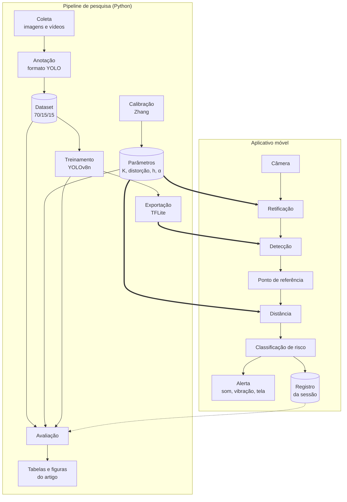

# 02 · Arquitetura

O SARMOV tem duas metades que compartilham o mesmo núcleo de cálculo:

- o **pipeline de pesquisa**, em Python, que roda no computador, treina o detector e produz todos os números do artigo;
- o **aplicativo móvel**, que executa o mesmo modelo e a mesma geometria no smartphone e emite o alerta.

Manter a geometria idêntica nas duas metades é o que permite afirmar, no artigo, que os erros medidos em bancada valem para o aplicativo nas mesmas condições, isto é, com a câmera parada.

## Visão de componentes



## Estágios do pipeline

### 1. Aquisição e retificação

O quadro é capturado e corrigido com os coeficientes de distorção $(k_1, k_2, p_1, p_2)$ obtidos na calibração. A equação de distância pressupõe imagem retificada.

A calibração só vale para o modo de captura em que foi feita. Resolução, recorte do modo vídeo, estabilização e foco automático alteram os parâmetros intrínsecos. Por isso o modo de captura do experimento deve ser fixado antes da calibração e registrado junto com ela.

### 2. Detecção

O YOLOv8n recebe o quadro e devolve, para cada detecção, a classe, a confiança e a caixa $(x_1, y_1, x_2, y_2)$. A variante *nano* foi escolhida pela compatibilidade com TensorFlow Lite no smartphone.

### 3. Ponto de referência

O cálculo de distância usa um único ponto por detecção: aquele em que o objeto toca o plano da via. A coordenada vertical depende da classe.

| Classe | Geometria | Coordenada $v$ |
|---|---|---|
| Obstáculo | Objeto elevado | $y_2$ (borda inferior) |
| Objeto na Pista | Genérico | $y_2$ (borda inferior) |
| Buraco | Depressão | $y_1$ (borda superior) |
| Irregularidade | Saliência | $(y_1 + y_2)/2$ |

A escolha para Buraco e Irregularidade será verificada experimentalmente; ver [Questões em aberto](04-questoes-em-aberto.md#q3--ponto-de-referência-da-classe-buraco).

### 4. Distância

$$d = \frac{h}{\tan\left(\alpha + \arctan\left(\dfrac{v - v_0}{f_y}\right)\right)}$$

| Símbolo | Significado | Origem |
|---|---|---|
| $d$ | Distância longitudinal (m) | Saída |
| $h$ | Altura da câmera sobre a via (m) | Trena, três repetições |
| $\alpha$ | Inclinação da câmera para baixo (rad) | Inclinômetro digital, três repetições |
| $v$ | Coordenada vertical do ponto de referência (px) | Estágio 3 |
| $v_0$ | Coordenada vertical do centro óptico (px) | Calibração |
| $f_y$ | Distância focal vertical (px) | Calibração |

A equação supõe via plana e só é definida para pontos abaixo do horizonte, isto é, com ângulo total positivo. Detecções acima do horizonte devem ser descartadas, não calculadas.

**Sensibilidade ao ângulo.** Chamando de $\theta$ o ângulo total, a derivada da equação fornece o erro relativo causado por um erro $\Delta\theta$:

$$\frac{\Delta d}{d} \approx \frac{h^2 + d^2}{h\,d}\,\Delta\theta$$

O erro cresce quase linearmente com a distância. Para uma altura ilustrativa de $h = 1{,}2$ m e $\Delta\theta = 0{,}5°$, que é a precisão do inclinômetro prevista no plano:

| Distância | Erro relativo por 0,5° |
|---|---|
| 1 m | 1,8 % |
| 5 m | 3,8 % |
| 10 m | 7,4 % |
| 15 m | 11,0 % |

Esses valores são uma aproximação de primeira ordem derivada da equação, não uma medição, e dependem da altura real da câmera. Eles indicam que, a 15 m, a incerteza do inclinômetro sozinha produz um erro próximo do limite de 15 %. Na média das oito distâncias do plano, a contribuição dessa incerteza ao MAPE fica em torno de 5 %. A consequência prática está em [Questões em aberto](04-questoes-em-aberto.md#q2--sensibilidade-ao-ângulo-de-inclinação).

### 5. Classificação de risco e alerta

Os limiares derivam da distância de frenagem segura [17]:

$$d_{\text{segura}} = v \cdot t_{\text{reação}} + \frac{v^2}{2\,a_{\text{fren}}}$$

Com $v = 40$ km/h, $t_{\text{reação}} = 1{,}5$ s e $a_{\text{fren}} = 6$ m/s², obtém-se $d_{\text{segura}} \approx 27$ m.

| Distância | Nível | Alerta |
|---|---|---|
| $d < 5$ m | Crítico | Som contínuo e vibração |
| $5 \le d < 15$ m | Atenção | Indicador luminoso e vibração leve |
| $d \ge 15$ m | Seguro | Monitoramento ativo |

Os valores são preliminares. A relação entre o limiar de 15 m e os 27 m da equação é discutida em [Questões em aberto](04-questoes-em-aberto.md#q1--limiares-de-alerta-e-distância-de-frenagem).

## Treinamento do detector

| Parâmetro | Valor |
|---|---|
| Modelo | YOLOv8n |
| Épocas | 100 |
| Tamanho do lote | 16 |
| Taxa de aprendizado | 0,001, com decaimento cosseno |
| Otimizador | SGD, momentum 0,937 |
| Decaimento de pesos | 0,0005 |
| Aumento de dados | Espelhamento, rotação ±10°, escala 0,8–1,2 |
| Parada antecipada | Paciência de 20 épocas |
| Sementes | 42 |
| Exportação | Melhor *checkpoint* por mAP de validação, em TFLite |

## Estrutura de código planejada

A estrutura abaixo é a proposta para a fase 4. O pacote `sarmov/`, `scripts/`, `configs/` e `tests/` já existem; `geometria` e `risco` têm a primeira implementação, `calibracao` e `avaliacao` estão vazios e `app/` ainda não foi criado.

```text
SARMOV/
├── sarmov/                  # pacote Python do pipeline de pesquisa
│   ├── calibracao/          # Zhang, retificação, leitura e escrita de parâmetros
│   ├── deteccao/            # treinamento, inferência e exportação do YOLOv8n
│   ├── geometria/           # ponto de referência e modelo pinhole
│   ├── risco/               # frenagem segura e classificação em níveis
│   └── avaliacao/           # MAE, RMSE, MAPE, mAP, matriz de confusão, IC
├── scripts/                 # pontos de entrada: calibrar, treinar, avaliar
├── configs/                 # hiperparâmetros e parâmetros de câmera versionados
├── tests/                   # testes do núcleo geométrico e das métricas
├── data/                    # fora do versionamento; apenas amostras anonimizadas
├── app/                     # aplicativo móvel (fase 6)
└── docs/                    # esta documentação
```

Três regras orientam a organização:

1. **`geometria` e `risco` não dependem de `deteccao`.** Recebem caixas e devolvem distâncias e níveis. Isso permite validar a geometria com caixas anotadas à mão antes de o detector existir, e isolar no artigo o erro geométrico do erro de detecção.
2. **Parâmetros de câmera são dados, não código.** Cada sessão de coleta referencia um arquivo de calibração versionado em `configs/`.
3. **Todo número do artigo sai de um script.** Tabelas e figuras são regeneráveis a partir do dataset e dos parâmetros.

## Decisões de arquitetura

| Decisão | Escolha | Motivo | Estado |
|---|---|---|---|
| Detector | YOLOv8n | Compatível com TFLite e leve o bastante para o aparelho | Definida no plano |
| Estimativa de distância | Geometria *pinhole* sobre plano | Interpretável, sem custo de inferência, erro analisável | Definida no plano |
| Calibração | Zhang via OpenCV | Método padrão, com critério objetivo de aceite | Definida no plano |
| Inferência no aparelho | TensorFlow Lite | Suporte a aceleração no Android | Definida no plano |
| Plataforma do aplicativo | Android nativo (Kotlin, CameraX) | Aparelho de prototipação é Android; menor sobrecarga na câmera | Proposta, a confirmar |
| Origem de `α` em uso real | Medição manual | Simplicidade; sensor inercial fica como extensão | Proposta, a confirmar |

O plano justifica apenas a escolha do YOLOv8n. Os demais motivos são leitura desta documentação.
