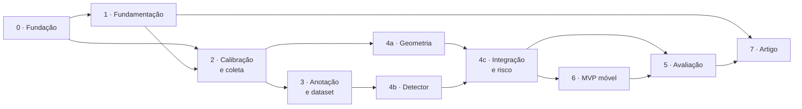

# 03 · Roteiro de fases

O plano de trabalho prevê doze meses de execução, divididos em seis bimestres (B1 a B6) e onze atividades. Este roteiro reagrupa as atividades em oito fases, cada uma encerrada por um critério de aceite verificável.

## Mapa de dependências

A geometria (4a) depende apenas da calibração e pode ser validada com caixas anotadas à mão enquanto o dataset ainda está sendo anotado. Como a estimativa de distância é o núcleo da contribuição, convém antecipá-la: se o erro geométrico for inaceitável, é melhor descobrir no terceiro bimestre do que no quinto.

## Fases

| Fase | Objetivo | Critério de aceite | Atividades |
|---|---|---|---|
| [0 · Fundação](fases/fase-0-fundacao.md) | Repositório, documentação e ambiente reprodutível | Ambiente instalável do zero a partir do repositório | — |
| [1 · Fundamentação](fases/fase-1-fundamentacao.md) | Revisão bibliográfica e domínio do YOLOv8 | Tabela comparativa e rascunho de trabalhos correlatos prontos; treino de referência executado | 1, 2 |
| [2 · Calibração e coleta](fases/fase-2-calibracao-e-coleta.md) | Parâmetros da câmera e imagens brutas | RMS < 0,5 px; ≥ 500 imagens controladas e ≥ 200 urbanas | 3, 4 |
| [3 · Anotação e dataset](fases/fase-3-anotacao-e-dataset.md) | Dataset anotado, revisado e dividido | Revisão dupla concluída; divisão 70/15/15 estratificada | 5 |
| [4 · Pipeline](fases/fase-4-pipeline.md) | Detecção, distância e risco integrados | Pipeline processa o conjunto de teste de ponta a ponta | 6 |
| [5 · Avaliação](fases/fase-5-avaliacao.md) | Experimentos e análise | Todas as tabelas e figuras do artigo geradas por script | 7, 8, 9 |
| [6 · MVP móvel](fases/fase-6-mvp-movel.md) | Aplicativo com alerta em tempo real | ≥ 10 fps no aparelho; distância igual à do pipeline Python | 6 |
| [7 · Artigo](fases/fase-7-artigo.md) | Relatórios e artigo | Artigo aprovado pelo orientador para submissão | 10, 11 |

## Cronograma

O plano de trabalho distribui as atividades da seguinte forma:

| Atividade | Bimestres previstos |
|---|---|
| 1. Revisão bibliográfica | 2 |
| 2. Estudo de YOLO | 3 |
| 3. Coleta de dados | 2 |
| 4. Calibração de câmera | 2 |
| 5. Anotação de imagens | 2 |
| 6. Implementação do método | 3 |
| 7. Avaliação da detecção | 2 |
| 8. Avaliação da distância | 2 |
| 9. Avaliação dos alertas | 2 |
| 10. Relatório parcial | 2 |
| 11. Artigo final | 1 |

A tabela acima registra a duração de cada atividade. A posição exata de cada atividade nos bimestres deve ser conferida na Tabela 5 do plano de trabalho. A distribuição das fases a seguir é uma **sugestão** desta documentação, guiada pelas dependências do mapa. Ela se afasta do plano em um ponto: a atividade 6 tem três bimestres no plano e aqui se estende por quatro (B3 a B6), porque o aplicativo da fase 6 foi contado como parte dela. Se o cronograma oficial não puder ser alterado, a fase 6 precisa caber em B5.

| Fase | B1 | B2 | B3 | B4 | B5 | B6 |
|---|:-:|:-:|:-:|:-:|:-:|:-:|
| 0 · Fundação | ● | | | | | |
| 1 · Fundamentação | ● | ● | ○ | | | |
| 2 · Calibração e coleta | | ● | ● | | | |
| 3 · Anotação e dataset | | | ● | ● | | |
| 4 · Pipeline | | | ● | ● | ● | |
| 5 · Avaliação | | | | ● | ● | ● |
| 6 · MVP móvel | | | | | ● | ● |
| 7 · Artigo | | | ● | ● | | ● |

● trabalho principal  ○ continuidade (estudo de YOLO)

## Pontos de controle

Três momentos em que vale parar e decidir, com o orientador, se o plano segue como está.

| Ponto | Quando | Pergunta | Se a resposta for não |
|---|---|---|---|
| PC1 | Fim da fase 2 | A calibração atingiu RMS < 0,5 px no modo de captura que será usado nos experimentos? | Refazer a calibração antes de coletar mais dados; imagens coletadas com parâmetros inválidos não servem para medir distância |
| PC2 | Fim da etapa 4a | Com caixas anotadas à mão, o erro de distância fica dentro da meta em toda a faixa de 1 a 15 m? | Revisar a medição de `α` e `h`, ou restringir a faixa declarada no artigo |
| PC3 | Meio da fase 5 | O detector atinge mAP > 0,75 com o dataset próprio? | Avaliar pré-treino em dataset público de danos viários ou reduzir o número de classes |

## Relatórios de fase

Ao encerrar uma fase, o documento correspondente recebe uma seção **Relatório de encerramento** com:

1. o que foi entregue, com ligação para os artefatos;
2. o resultado medido em cada critério de aceite;
3. os desvios em relação ao plano e o motivo;
4. o que muda nas fases seguintes.

Esses relatórios são a matéria-prima do relatório parcial e do artigo final previstos no cronograma.
