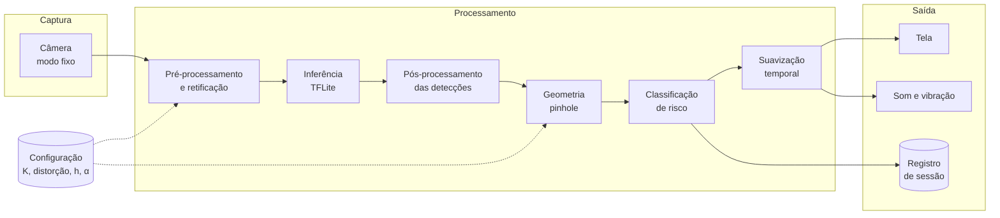

# Plano do MVP

O produto mínimo que demonstra o SARMOV funcionando: um aplicativo que, com o smartphone fixado no painel, avisa o motorista quando há um risco na via à frente e a que distância.

## O que o MVP precisa provar

1. O pipeline validado em bancada roda no aparelho em tempo real.
2. A distância mostrada pelo aplicativo é a mesma que o pipeline de pesquisa calcula.
3. O alerta chega ao motorista sem exigir que ele olhe para a tela.

O MVP não precisa provar que o sistema é seguro para uso irrestrito no trânsito. Essa é uma pergunta para depois da validação em movimento.

## Dois degraus

| Degrau | O que é | Quando | Serve para |
|---|---|---|---|
| **MVP 0 · Bancada** | Programa em Python que recebe um vídeo e devolve o vídeo anotado com caixas, distâncias e nível de risco, além de um arquivo com os dados | Etapa 4c | Demonstrar o método, depurar a geometria, gerar os resultados do artigo |
| **MVP 1 · Aplicativo** | Aplicativo Android com câmera ao vivo e alerta | Fase 6 | Demonstrar a operação em tempo real e medir o desempenho no aparelho |

O MVP 0 sai quase de graça do trabalho de pesquisa e reduz o risco do MVP 1: quando o aplicativo começar a ser construído, o método já estará validado.

## Usuário e cenário

Motorista de veículo sem sistema de assistência, em via urbana, com o smartphone em suporte fixo no painel ou no para-brisa, câmera traseira voltada para a frente.

## Requisitos funcionais

| # | Requisito | Prioridade |
|---|---|---|
| RF1 | Capturar a câmera traseira no modo de captura usado na calibração | Essencial |
| RF2 | Detectar as quatro classes de risco no aparelho, sem conexão | Essencial |
| RF3 | Estimar a distância de cada detecção pelo modelo *pinhole* | Essencial |
| RF4 | Classificar cada detecção em Crítico, Atenção ou Seguro | Essencial |
| RF5 | Emitir o alerta do nível mais grave em cena, conforme a tabela do plano: som contínuo e vibração no Crítico; indicador luminoso e vibração leve no Atenção; nenhum alerta no Seguro | Essencial |
| RF6 | Mostrar na tela as caixas, a distância e o nível | Essencial |
| RF7 | Permitir informar a altura e a inclinação da câmera e carregar os parâmetros de calibração | Essencial |
| RF8 | Registrar a sessão em arquivo exportável | Essencial |
| RF9 | Suavizar o alerta ao longo de alguns quadros, para evitar disparos isolados | Desejável |
| RF10 | Ler a inclinação pelo sensor inercial do aparelho | Extensão |
| RF11 | Ajustar os limiares pela velocidade lida do GPS | Extensão |

RF8 é essencial porque é o que liga o aplicativo ao artigo: o registro de sessão alimenta o experimento de desempenho.

## Requisitos não funcionais

| # | Requisito | Meta |
|---|---|---|
| RNF1 | Taxa de quadros | ≥ 10 fps |
| RNF2 | Tempo por quadro | ≤ 100 ms |
| RNF3 | Funcionamento sem rede | Total |
| RNF4 | Privacidade | Nenhuma imagem sai do aparelho; o registro de sessão não guarda quadros por padrão |
| RNF5 | Estabilidade | Sessão de 30 minutos sem falha e sem queda abaixo de 10 fps |
| RNF6 | Fidelidade | Distância igual à do pipeline Python, dentro de tolerância numérica |

## Fora do escopo

- iOS
- Publicação em loja de aplicativos
- Processamento em nuvem ou contas de usuário
- Posição lateral do risco e sugestão de manobra
- Mapa colaborativo de defeitos viários
- Uso com o veículo em movimento como condição de aceite

## Arquitetura do aplicativo

**Plataforma proposta:** Android nativo, com Kotlin, CameraX para a captura e TensorFlow Lite para a inferência. O aparelho de prototipação é Android, e o acesso direto à câmera facilita fixar resolução, foco e estabilização, o que a calibração exige. A decisão deve ser confirmada com o orientador antes da fase 6.

### Registro de sessão

Uma linha por detecção, em arquivo de texto tabular:

| Campo | Conteúdo |
|---|---|
| `instante_ms` | Tempo desde o início da sessão |
| `quadro` | Número do quadro |
| `classe` | Classe detectada |
| `confianca` | Confiança da detecção |
| `x1`, `y1`, `x2`, `y2` | Caixa delimitadora, em pixels |
| `distancia_m` | Distância estimada |
| `nivel` | Crítico, Atenção ou Seguro |
| `tempo_quadro_ms` | Tempo de processamento do quadro |

O cabeçalho do arquivo guarda `h`, `α`, o identificador da calibração, o modelo do aparelho e a versão do aplicativo.

## Validação do MVP

| Teste | Procedimento | Aceite |
|---|---|---|
| Fidelidade | Processar o mesmo conjunto de imagens no aplicativo e no Python | Distâncias coincidem dentro da tolerância |
| Desempenho | Sessão contínua de 30 minutos, registrando o tempo por quadro | ≥ 10 fps durante toda a sessão |
| Alerta em bancada | Objetos a 2, 10 e 18 m, afastados dos limiares de 5 e 15 m | Nível correto e alerta correspondente em cada caso |
| Configuração | Alterar `h` e `α` e repetir uma medição | A distância muda como a equação prevê |

## Segurança no uso

- O alerta crítico é sonoro e tátil; a tela é apoio, não requisito.
- A tela inicial informa que o aplicativo é um protótipo de pesquisa e não substitui a atenção do motorista.
- Os testes de aceite são feitos em bancada. Qualquer teste em veículo é feito com um passageiro operando o aparelho.

## Depois do MVP

Em ordem de valor para a pesquisa: leitura da inclinação pelo sensor inercial, limiares ajustados pela velocidade, avaliação em vídeo contínuo e teste em outros aparelhos. A leitura do sensor inercial, o vídeo contínuo e os outros aparelhos constam do plano de trabalho como possibilidades de continuidade, ao lado da profundidade por aprendizado profundo. O ajuste dos limiares pela velocidade é proposta desta documentação, ligada à [questão Q1](../04-questoes-em-aberto.md#q1--limiares-de-alerta-e-distância-de-frenagem).
